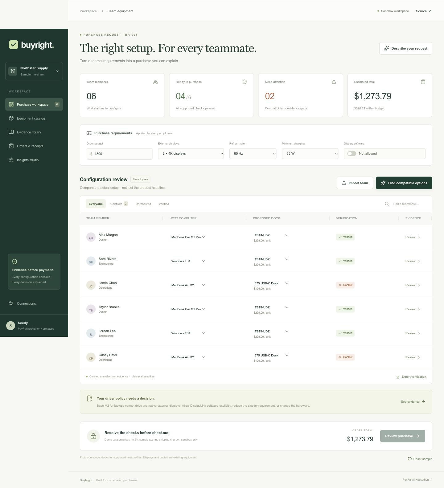
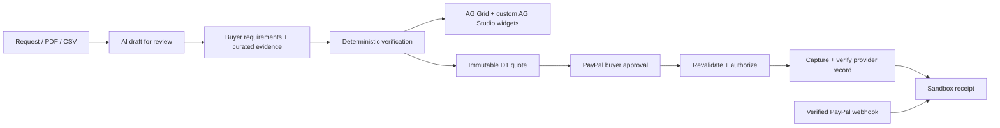

# BuyRight

**Buy with evidence.** A purchasing workspace that checks whether a team's proposed docking stations meet its actual computer, display, software, power, and budget requirements before PayPal checkout.

Built for the [PayPal AI Hackathon](https://paypalaihackathon.devpost.com/). This is a working prototype, not a submitted or prize-winning entry.



## The demo

Six people need two 4K displays at 60Hz. A cheap dock looks suitable until its dual-display footnote reveals a 30Hz limit. BuyRight exposes that conflict, proposes compatible alternatives, and catches the harder exception: base M2 Air laptops still cannot drive two native external displays under a no-additional-driver policy.

The buyer must explicitly allow DisplayLink software, change the display requirement, or change hardware. The assistant cannot quietly relax policy to get a sale. After all checks pass, the buyer reviews the exact USD quote and approves a PayPal sandbox order.

## What works today

- Editable six-person sample, CSV roster import, four-product curated catalog, filtering, evidence drawers, and JSON audit export.
- Deterministic verification and cheapest-compatible selection without changing buyer policy. Unknown host or dock evidence blocks checkout.
- AI request intake and PDF manual analysis through server-side Anthropic Messages; structured results require human review. No model key is shipped.
- AG Grid configuration matrix, AG Studio custom readiness/budget/evidence widgets, custom theme and movable layout. An AG Studio agent-framework analyst explains the current server-evaluated audit through Anthropic; it cannot approve payments.
- PayPal sandbox Orders v2 create → buyer approval → authorize → Payments v2 capture. D1 stores immutable approval snapshots and payment references. Server checks totals, currency, recipient, SKU and quantity. Stable request IDs, conditional state transitions, reconciliation, and signature-verified completion webhooks handle retries.
- Eleven automated tests for compatibility, unknown evidence, budgets, CSV, snapshot tampering and provider-response validation; GitHub Actions checks types, tests and build.

**Verification status:** local build, TypeScript checks, unit tests, HTTP authentication/input smoke checks and desktop/mobile browser interaction checks pass. Real Anthropic responses, PayPal sandbox authorization/capture/webhook delivery and licensed AG Studio operation still require credentials and end-to-end testing. No successful payment or AI evaluation benchmark is claimed.

## Run locally

Node 22.13+ and npm are required. This app uses React, Next App Router APIs, Vinext/Vite and Cloudflare D1. All runtime/build support files are included; a Codex subscription is not needed to run the local sample.

```sh
npm ci
cp .env.example .dev.vars
npm run build
node --import ./scripts/sites-env.mjs ./node_modules/wrangler/bin/wrangler.js d1 execute DB --local --config dist/server/wrangler.json --persist-to .wrangler/state --file drizzle/0000_slim_scrambler.sql
npm run dev
```

Open the printed local URL (normally http://127.0.0.1:5173). Apply the initial migration once to a new local database. Subsequent schema changes need new migrations. Do not reapply the same SQL to an initialized database.

Open **Connections → Sign in** for the local development identity. That identity is only a development convenience; the hosted app trusts Sites' authenticated edge headers. Do not expose the development server or deploy this header-based auth code behind an untrusted proxy.

### Private configuration

Fill `.dev.vars` locally. It is Git-ignored. Hosted Sites uses its runtime environment settings; local secrets are not uploaded automatically.

| Variable | Purpose |
| --- | --- |
| `PAYPAL_CLIENT_ID` | PayPal **sandbox** app client ID; public SDK identifier |
| `PAYPAL_CLIENT_SECRET` | Sandbox app secret; server only |
| `PAYPAL_MERCHANT_ID` | Merchant ID for the sandbox business account owning the app |
| `PAYPAL_WEBHOOK_ID` | Webhook registration ID for this app and endpoint |
| `ANTHROPIC_API_KEY` | Server-side Anthropic API key |
| `ANTHROPIC_MODEL` | Messages-compatible model available to your account |
| `AG_STUDIO_LICENSE_KEY` | AG Studio evaluation/production license; client-side license by design |

Use a separate PayPal sandbox personal account to approve test purchases. Register `/api/paypal/webhook` for `PAYMENT.CAPTURE.COMPLETED` at an HTTPS address reachable by PayPal. An owner-private preview cannot receive external webhooks; local manual testing or a publicly reachable deployment is required. Missing credentials disable the affected feature rather than simulate success. AI is limited to 30 requests per signed-in user per UTC day, shared across intake and Studio.

Never use live payment credentials: the backend is fixed to `api-m.sandbox.paypal.com`.

## Try the core flow without API keys

1. Start with the sample: six conflicts, checkout blocked.
2. Choose **Find compatible options**: four pass, two remain blocked. The policy has not changed.
3. Inspect an M2 Air row and its manufacturer evidence.
4. Explicitly allow display software, then find options again: all six pass, total **$1,295.49** including sample tax.
5. Reduce the budget below that total: checkout blocks again.
6. Open **Insights studio** to inspect the live custom widgets. The analyst requires AI configuration and sign-in.
7. Restore the budget and review the purchase. Without PayPal credentials the app clearly shows connection requirements, not a fake receipt.

## Architecture



Relevant code: `lib/buyright/engine.ts`, `payment-validation.ts`, `catalog.ts`; `app/api/{ai,studio,verify,orders}`; `app/api/paypal/webhook`; `components/buyright/{workspace,matrix,studio,checkout}.tsx`.

Provider calls are server-side. The browser never supplies an authoritative amount. Retries reuse the local purchase UUID and stable PayPal request IDs, with a conservative five-hour automatic-retry window. A stale processing lease can be reconciled after two minutes. This is not an exactly-once transaction guarantee across PayPal and D1; ambiguous outcomes require provider reconciliation. Refund/reversal lifecycle and fulfillment are outside this prototype.

## Scope and evidence boundaries

- Docks only; monitors, cables and workstation configuration are existing equipment. Windows TB4 is a deliberately verified profile, not a claim that every Windows computer works.
- Catalog prices and 8.5% tax are illustrative fixtures. No current-price, inventory, tax-compliance, shipping or merchant-affiliation claim is made.
- Manufacturer snippets and links are curated. Uploaded AI findings never change the trusted catalog automatically. They require independent source review.
- Draft roster/policy and Studio layouts remain in browser memory. Payment records persist in D1 and are scoped to the authenticated owner. PDFs are sent to Anthropic on explicit analysis and are not stored by this app; provider handling follows your provider account terms.
- Compatibility is restricted to documented profiles and specified port configuration. Firmware, individual cables, display modes and deployment-specific IT restrictions still matter.
- AG Studio is a commercial dependency. An evaluation watermark is expected without a valid key; MIT licensing of this project does not grant a license to AG Studio.

## Validation and submission

```sh
npm run typecheck
npm test
npm run build
# With the local dev server running:
npm run test:smoke
```

See [the demo script](docs/demo-script.md) and [the acceptance checklist](docs/acceptance.md) before recording or submitting. A public GitHub repository alone does not make this a complete hackathon entry. Connect and exercise the actual PayPal/AI paths, obtain AG Studio trial access, and record a working demo under three minutes.

References: [PayPal delayed capture](https://developer.paypal.com/checkout/delay-capture/), [Payments v2](https://developer.paypal.com/api/payments/v2), [AG Studio](https://www.ag-grid.com/studio/react/quick-start/), [Anthropic Messages](https://platform.claude.com/docs/en/api/messages), [hackathon requirements](https://paypalaihackathon.devpost.com/).

Original application code: MIT. Third-party packages and the included Sites build support retain their respective licenses.
